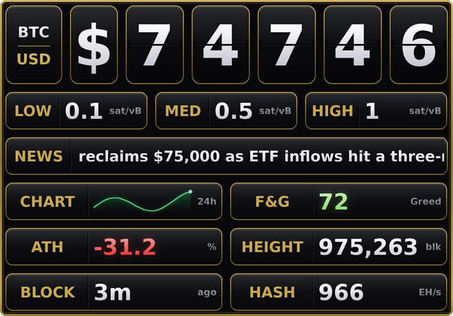
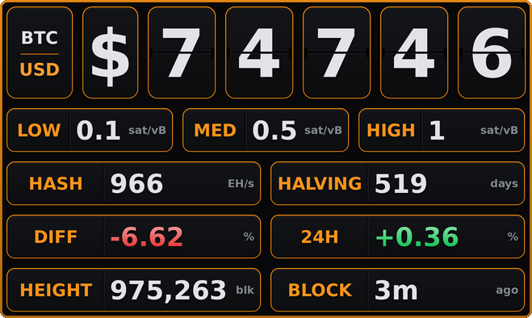

<p align="center">
  
</p>

<h1 align="center">Tickoshi</h1>

<p align="center">
  A live Bitcoin price ticker for your desktop — inspired by the Coinkite BlockClock Mini.
</p>

<p align="center">
  
</p>

<p align="center">
  
  
</p>
<p align="center">

</p>
<p align="center">

</p>

## Features

- **Live price** — customizable refresh interval (1 min – 1 hr) via CoinGecko (Binance fallback)
- **Modular secondary tiles** — pick any combination of Fees, Sats, 24h Change, Block Height, Block Age, Halving, Difficulty, Hashrate, Mempool, News, Price Chart, Fear & Greed, All-Time High. Tiles stack under the price in the order you enable them and auto-pair two-per-row to keep the widget compact
- **Live mempool feed** — LOW / MED / HIGH priority sat/vB values streamed from mempool.space's WebSocket, matching the site's homepage tiles exactly
- **Hashrate + mempool size** — network health tiles (EH/s and MB) fed from mempool.space
- **News ticker** — Bitcoin headlines from Bitcoin Magazine, CoinDesk and Cointelegraph scroll through a full-width tile. Hover to pause, double-click a headline to open it in your browser
- **Price chart** — a 24-hour line, green when it ends higher than it started and red when lower
- **Fear & Greed + all-time high** — the market sentiment index, and how far the price sits below its record
- **Block flash** — the rim lights up the moment a new block is mined
- **24h change** — signed percentage move, arriving on the same request as the price
- **Block age + difficulty retarget** — seconds since the last block, ticking live, and the projected change at the next retarget
- **Start at login** — one menu toggle, registered with the OS (Windows, macOS and Linux)
- **Currency sign panel** — displays $, ₺, €, £, ¥, ₽ next to the price
- **Split-flap animation** — each digit card folds over on its hinge when the price changes
- **Accordion layout** — panels adjust automatically to match the digit count
- **Price flash** — the rim glows green (up) or red (down) on price changes
- **6 currencies** — USD · TRY · EUR · GBP · JPY · RUB
- **Any size from 75% to 300%** — presets in the menu, or Ctrl + mouse wheel for 5% steps
- **3 border colors** — Gold · Bitcoin orange · White
- **2 finishes** — Gloss (glass highlights, metallic rim, soft glows) or Matte (the same cards, flat and quiet)
- **Opacity control** — 50% · 70% · 85% · 100%
- **Always-on-top toggle** — keep it above all windows, or let it blend in
- **Frameless & draggable** — click and drag anywhere to reposition
- **Rearrange tiles** — press and hold a tile, then drag it onto another to move it there
- **Lock** — freeze position so you don't drag it by accident
- **Double-click to copy** — copies current value to clipboard
- **Persistent config** — all settings are remembered between sessions

---

## Running from source

Requires Python 3.10+ and two pip packages:

```bash
pip install websocket-client "pillow>=10.1"
python Tickoshi.py
```

> **Linux:** make sure `python3-tk` is installed.
> ```bash
> # Ubuntu / Debian
> sudo apt install python3-tk
> ```

---

## Building a standalone binary

### Windows

Double-click **`BUILD.bat`** or run from a terminal:

```bat
BUILD.bat
```

Produces `dist\Tickoshi.exe` — a single, portable EXE with no Python required.

### Linux

```bash
chmod +x BUILD.sh
./BUILD.sh
```

Produces `dist/Tickoshi` — a single ELF binary. A `.desktop` launcher is also created automatically at `~/.local/share/applications/tickoshi.desktop`.

### macOS

Double-click **`BUILD.command`** in Finder, or run from a terminal:

```bash
chmod +x BUILD.command
./BUILD.command
```

Produces `dist/Tickoshi.app` (ad-hoc signed) and `dist/Tickoshi-macos.zip` (ready for release upload).

> **First launch (Gatekeeper):** macOS will refuse to open the app because it isn't notarized. Right-click the app → **Open** (then confirm), or run:
> ```bash
> xattr -d com.apple.quarantine dist/Tickoshi.app
> ```

> **macOS + HTTPS:** Python's OpenSSL on macOS can't read the system Keychain, so the app falls back to [`certifi`](https://pypi.org/project/certifi/)'s CA bundle (installed and bundled by `BUILD.command` automatically). Builds made before this fix show no data at all — every HTTPS/WSS request failed certificate verification. Rebuild with the current `BUILD.command` to fix.

> All three build scripts install PyInstaller, Pillow, and `websocket-client` automatically (plus `certifi` on macOS). An older Pillow is upgraded to 10.1 or newer.

---

## Usage

| Action | How |
|---|---|
| Move widget | Click and drag anywhere |
| Reorder tiles | Press and hold a tile for half a second, then drag it onto another tile (off while **Lock** is on) |
| Copy value to clipboard | Double-click |
| Open a headline | Double-click it in the **News** tile (hover to pause the ticker) |
| Toggle tiles | Right-click → **View** (multi-select) |
| Change size | Right-click → **Size**, or **Ctrl + mouse wheel** over the widget |
| Change currency | Right-click → **Currency** |
| Change refresh rate | Right-click → **Refresh** |
| Change opacity | Right-click → **Opacity** |
| Change border color | Right-click → **Border** |
| Switch gloss / matte | Right-click → **Finish** |
| Toggle always-on-top | Right-click → **Always on top** |
| Toggle price flash | Right-click → **Price flash** |
| Toggle new-block flash | Right-click → **Block flash** |
| Start with the computer | Right-click → **Start at login** |
| Lock position | Right-click → **Lock** |
| Close | Right-click → **Close** |

### Secondary tiles

The main row always shows the live BTC price. Enable any of these optional tiles from the **View** menu to stack them underneath. Tiles appear in the order you toggle them on and pair up two per row; News and Fees take a full row each. Press and hold a tile, then drag it onto another, to change the order.

| Tile | Shows | Source |
|---|---|---|
| **Fees** | Low / Medium / High priority (sat/vB) | mempool.space WebSocket |
| **Sats** | Sats per unit of selected currency | Computed from price |
| **24h Change** | Signed % move over 24 hours | CoinGecko (same request as the price) |
| **Block Height** | Current block number | mempool.space WebSocket, blockchain.info fallback |
| **Block Age** | Time since the last block, ticking | mempool.space WebSocket |
| **Halving** | Days until next halving | Computed from block height |
| **Difficulty** | Projected % change at the next retarget | mempool.space WebSocket |
| **Hashrate** | Network hashrate (EH/s, 3-day avg) | mempool.space |
| **Mempool** | Unconfirmed vBytes (MB) | mempool.space WebSocket |
| **News** | Scrolling Bitcoin headlines, newest first (full-width row) | RSS: Bitcoin Magazine, CoinDesk (Bitcoin stories only), Cointelegraph |
| **Price Chart** | Last 24 hours as a line | CoinGecko |
| **Fear & Greed** | Sentiment index 0–100 and its label | alternative.me |
| **All-Time High** | % below the all-time high | CoinGecko |

> The 24h Change tile reads `--` when the price came from the Binance fallback: that endpoint carries no 24h figure, and a stale percentage beside a fresh price would be worse than none.

### Supported currencies

| Code | Pair |
|---|---|
| USD | BTC / US Dollar |
| TRY | BTC / Turkish Lira |
| EUR | BTC / Euro |
| GBP | BTC / British Pound |
| JPY | BTC / Japanese Yen |
| RUB | BTC / Russian Ruble |

### Refresh intervals

1 min · 5 min · 15 min · 30 min · 1 hr

Fees, mempool size, block height/age and difficulty push over a persistent WebSocket and update independently of this interval. News, the price chart, Fear & Greed and the all-time high refresh every 10 minutes on their own, whatever interval is chosen here. A cycle that fetches no live price retries within seconds rather than waiting out the whole interval.

---

## Config

Settings are saved automatically when you move, resize, or change any option.

| Platform | Location |
|---|---|
| Windows | `%APPDATA%\Tickoshi\tickoshi_config.json` |
| macOS | `~/Library/Application Support/Tickoshi/tickoshi_config.json` |
| Linux | `~/.config/Tickoshi/tickoshi_config.json` |

A rolling `tickoshi_debug.log` (last 200 lines) sits alongside the config for troubleshooting the WebSocket feed.

---

## Tech stack

| | |
|---|---|
| UI | Python / Tkinter for the window and layout; every tile is drawn with [Pillow](https://pypi.org/project/pillow/) |
| Dependencies | [`websocket-client`](https://pypi.org/project/websocket-client/) · [`pillow`](https://pypi.org/project/pillow/) 10.1+ |
| Price API | [CoinGecko](https://www.coingecko.com/) (primary) · Binance (fallback) |
| Block height | [blockchain.info](https://blockchain.info/) |
| News | RSS feeds of [Bitcoin Magazine](https://bitcoinmagazine.com/), [CoinDesk](https://www.coindesk.com/) and [Cointelegraph](https://cointelegraph.com/) |
| Fear & Greed | [alternative.me](https://alternative.me/crypto/fear-and-greed-index/) |
| Fees + mempool size | [mempool.space WebSocket](https://mempool.space/docs/api/websocket) (`wss://mempool.space/api/v1/ws`) |
| Hashrate | [mempool.space mining API](https://mempool.space/docs/api/rest#get-hashrate) |
| Build | [PyInstaller](https://pyinstaller.org/) |

---

## Support

Tickoshi is free and open source. If it earns a spot on your desktop and you'd like to buy me a coffee, these go straight to me, with no platform in between. There is also a [support page](https://cervezagua.github.io/Tickoshi/) with QR codes and copy buttons.

| | |
|---|---|
| ⚡ **Lightning** | `cervezagua@fountain.fm` |
| ₿ **Bitcoin** | `bc1q75hd4vtzjtdlphu3r9ppgnsdrg090dcvs9nllp` |
| ɱ **Monero (XMR)** | `45zDqGv4jm1P8FXx9uEwZjcTLuS4HmuWU39DY7Mt7p46JZ15Vb4dzCzHRZXLyyDn48MBcwffb5GGSWLsAbeKNfiKU3F2L2W` |
